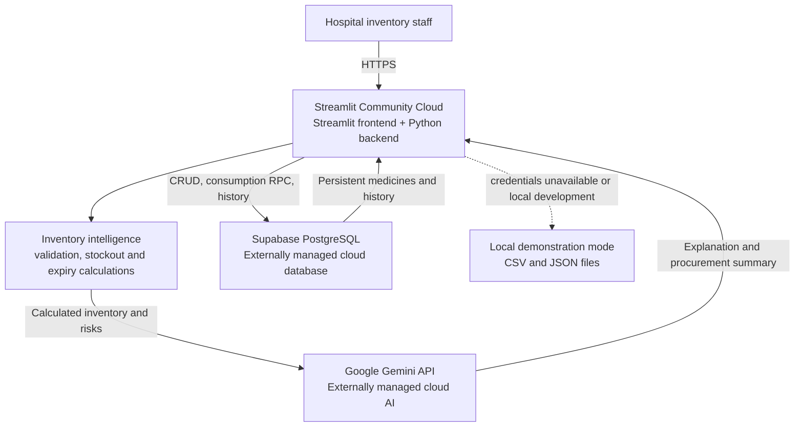

# MedStock Sentinel

An academic cloud computing prototype for monitoring synthetic medicine inventory at small hospitals and Primary Health Centres. It demonstrates Streamlit, Python inventory intelligence, Supabase PostgreSQL persistence, consumption and recommendation history, and optional Gemini explanations. **It uses synthetic data only; alerts and recommendations are operational inventory support, not medical advice.**

## Architecture



The Streamlit Python process is the backend. Supabase and Gemini are external managed services; this repository does not provision their projects. Streamlit Community Cloud can host the app. `modules/` contains the Python calculation and AI services, and `database/` contains persistence and SQL setup.

## Implemented features

- Dashboard KPIs, interactive charts, critical stock and upcoming expiry alerts.
- Medicine create, edit, delete, search, category/risk filtering, and CSV append/replace import.
- Validation and explainable days-of-cover, reorder point, stockout risk, expiry risk and suggested quantity calculations.
- Optional Gemini explanations that receive calculated inventory fields; deterministic rule-based recommendations remain available when Gemini is missing or fails.
- Supabase inventory read, insert/update upsert, deletion, connection check, consumption history and recommendation history.
- A database function records consumption and decrements stock in one PostgreSQL transaction.
- Explicit local demonstration mode using the supplied 24-row synthetic inventory and git-ignored local history files.

## Local setup

Python 3.10 or newer is recommended. PowerShell commands:

```powershell
cd D:\medstock-sentinel
py -m venv .venv
.venv\Scripts\Activate.ps1
python -m pip install --upgrade pip
pip install -r requirements.txt
Copy-Item .env.example .env
streamlit run app.py
```

With blank cloud credentials the sidebar says **LOCAL DEMONSTRATION MODE**. The first edit copies the bundled synthetic rows to `data/local_inventory.csv`; analysis and consumption history are stored locally. These local files are ignored by Git. A partial Supabase configuration is shown as an error and uses local mode. When full Supabase credentials are configured but requests fail, the app reports the failure and does **not** silently write cloud changes to local storage.

## Supabase setup

1. Create a Supabase project.
2. Open its SQL Editor and run [`database/schema.sql`](database/schema.sql).
3. Configure `SUPABASE_URL` as the project base URL (for example, `https://<project-ref>.supabase.co`) and `SUPABASE_KEY` using environment variables or Streamlit secrets. Do not append `/rest/v1`; the SDK appends that path. The adapter strips a trailing `/rest/v1` for compatibility and shows a non-secret warning. The app defaults `SUPABASE_TABLE` to `medicines`.
4. Use a **server-side service-role key** only in the Streamlit Python runtime. The app does not send this key to browser code. Never use or commit a real key in `.env.example`, source, or Git.
5. Use the sidebar connection check or observe a successful inventory load for a live connectivity check.

The schema enables Row Level Security on all tables and provides no `anon` or `authenticated` access policies. The service-role key bypasses RLS, so it must remain a server secret. Streamlit Community Cloud stores configured secrets server-side. Restrict access to deployed apps: this prototype has no staff login/role system, so anyone allowed to use the app can perform inventory operations through its backend. For real deployments add staff authentication, role-based authorization, audit/retention policy, and review the service key permissions.

`record_medicine_consumption` validates available stock, decrements it and inserts a history row atomically. Recommendation history stores the provider, returned summary and calculated inventory snapshot. The schema includes timestamps and update triggers. Local fallback consumption and recommendation history are separate ignored files.

## Gemini setup

Set `GEMINI_API_KEY` and optionally `GEMINI_MODEL` (default `gemini-2.5-flash`). The app uses the official `google-genai` SDK. It sends synthetic medicine inventory details and Python-calculated fields (stockout cover, reorder point, risk, expiry and suggested quantity) so Gemini can explain the results. Gemini is asked for qualitative prose only; responses containing numeric claims are rejected, and exact figures remain in a separate Python-calculated evidence table. API errors, empty responses, and invalid numeric output switch to the labeled rules result. No real patient data belongs in this prototype.

The UI shows whether a key is configured and reports success/fallback after a request. A configured key by itself is not proof of a live Gemini connection; a successful request is required.

## Streamlit Community Cloud deployment

1. Push this repository to a private or public GitHub repository. Do not include `.env`, service-role keys, or local data files.
2. Create the Supabase project and run `database/schema.sql`.
3. In Streamlit Community Cloud, create an app from the repository, select `app.py` as the entry point, and configure **Advanced settings → Secrets**:

   ```toml
   SUPABASE_URL = "https://YOUR_PROJECT.supabase.co"
   SUPABASE_KEY = "YOUR_SERVER_SIDE_SERVICE_ROLE_KEY"
   SUPABASE_TABLE = "medicines"
   GEMINI_API_KEY = "YOUR_GOOGLE_AI_STUDIO_KEY"
   GEMINI_MODEL = "gemini-2.5-flash"
   ```

4. Deploy and inspect the sidebar. It should report a successful Supabase read/connection. Generate one Gemini recommendation to verify the configured model. If either credential is omitted, the app continues with the corresponding local/rule-based mode.

Streamlit Community Cloud deploys from GitHub and installs [`requirements.txt`](requirements.txt). No container or custom server command is required. The app has not been deployed by this repository setup.

## Configuration reference

| Setting | Required for | Source |
|---|---|---|
| `SUPABASE_URL` | Cloud database | `.env` for local development or Streamlit secrets |
| `SUPABASE_KEY` | Cloud database | Server-side service-role key in `.env` or Streamlit secrets |
| `SUPABASE_TABLE` | Optional table override | Defaults to `medicines` |
| `GEMINI_API_KEY` | Gemini analysis | `.env` or Streamlit secrets |
| `GEMINI_MODEL` | Optional model override | Defaults to `gemini-2.5-flash` |

`modules/config.py` reads environment values first, then Streamlit secrets. Secret values are not rendered in the UI or included in error messages.

## CSV import format

```text
medicine_id,medicine_name,category,current_stock,average_daily_consumption,supplier_lead_time,safety_stock,reorder_quantity,manufacturing_date,expiry_date,supplier_name
```

Dates must be valid dates (ISO `YYYY-MM-DD` recommended); numeric values must be finite and non-negative; IDs must be unique. The Inventory Management page offers a downloadable template.

## Calculation definitions

- Days until stockout = floor(current stock / average daily consumption). Zero consumption means unknown cover.
- Reorder point = average daily consumption × supplier lead time + safety stock.
- Critical: stock at or below safety stock. High: cover at or below supplier lead time. Moderate: stock at or below reorder point. Otherwise Low.
- Expiry: Expired below 0 days, Critical within 30 days, Soon within 90 days, otherwise Low.
- Suggested quantity for Moderate/High/Critical = max(0, reorder point + configured reorder quantity − current stock); otherwise 0.

These transparent heuristics do not model changing demand. `modules/forecasting.py` includes a small linear-trend helper for future historical usage work, but it is not trained or used for the current warnings. Consumption history is retained for later evaluation or forecasting.

## Tests and validation

```powershell
python -m pytest -q
python -m compileall -q app.py modules database tests
streamlit run app.py
```

Automated tests cover calculations, CSV parsing and validation, local persistence, mocked Supabase CRUD/failure behavior, and mocked Gemini success/invalid response/failure handling. Mocked service tests do not establish live cloud connectivity; only a successful request using configured credentials does. See the final project report for the connectivity status verified in this workspace.

## Troubleshooting

- **LOCAL DEMONSTRATION MODE:** confirm both Supabase settings are present; restart Streamlit after editing `.env`.
- **Supabase configured but unavailable:** confirm the project URL/key, schema was executed, network access is available, and the key is a server-side key with permissions. Errors do not include the secret value.
- **Gemini fallback:** confirm the API key/model and service availability; rules remain available without Gemini.
- **RLS/permission errors:** this app uses server-side service-role access because it has no end-user authentication. Do not add public RLS policies as a workaround.
- **Deployment reset:** local files are ephemeral on hosted instances; configure Supabase for durable storage.
